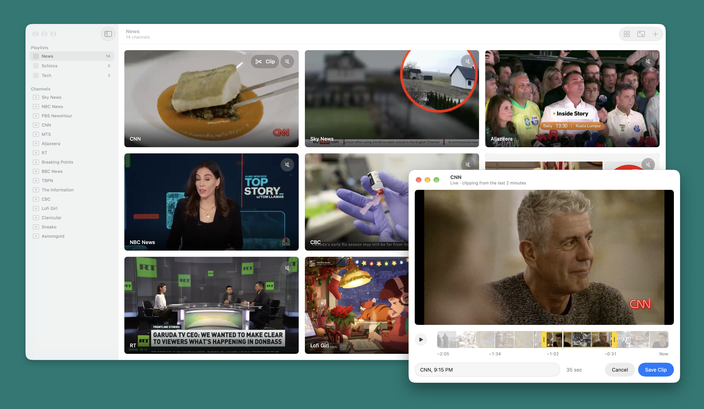

# Watch

A Mac app for keeping an eye on several live channels at once. It shows a grid of YouTube, Rumble, and Kick streams in one window, plays the sound of whichever one you pick, and lets you cut a clip out of the last two minutes of any of them.

Streams are played natively with AVPlayer: no web views and no re-encoding. YouTube streams are found with `yt-dlp` (`brew install yt-dlp`); Rumble and Kick are read straight from the site.

This is a rewrite of an earlier single-window version. The Mac app works. The iOS target builds and shares the code, but nothing has been designed for it yet.

## Run

    make run        # debug build, then launch
    make build      # build only
    make test       # unit tests

`open app/Watch.xcodeproj` to work on it in Xcode. The app targets are thin shells; the code lives in two local packages, `WatchCore` (the library, stream resolvers, and clip export) and `WatchKit` (the interface).

The app is not sandboxed, because it runs `yt-dlp` as a subprocess. That rules out the Mac App Store.

## Channels

A channel is a live source on YouTube, Rumble, or Kick. The sidebar's Channels section is the library: every channel Watch knows about. Add one with **+ ▸ Add Channel…** (⇧⌘N) by pasting a channel URL, an `@handle`, a `UC…` ID, `rumble:name`, or `kick:name`, and optionally giving it a friendlier name.

Click a channel in the sidebar to watch it on its own. Right-click it to rename it, add it to a playlist, or delete it.

## Playlists

A playlist is a named set of channels shown as a grid. The grid is 2×2 or 3×3; those are the only two sizes. A playlist can hold more channels than its grid shows, and the ones that aren't on screen wait their turn.

- **Right-click a tile** to choose which of the playlist's channels it shows. Picking one that's on another tile swaps the two without reloading either. The same menu adds a channel from the library to the playlist or removes one.
- **Drag a tile onto another** to swap them.
- **Drag a channel from the sidebar** onto a tile to put it there, or onto a playlist to add it.
- **Right-click a playlist** in the sidebar to rename it, switch between 2×2 and 3×3 (⌘4, ⌘9), or delete it.

Going from 3×3 to 2×2 hides five tiles but remembers what was on them.

## Watching

- Click a tile, press its number (1–9), or press its speaker button to hear it. Everything else is muted. `M` mutes everything.
- Double-click a tile, or press the zoom button in the toolbar, to make it fill the grid. Double-click again or press Esc to go back. Tiles hidden behind a zoomed one are paused and jump to live when they return. While zoomed, the number keys flip between channels.
- The first toolbar button switches between tiles spaced apart and tiles edge to edge (⇧⌘P).
- Hover over a tile and press the Picture in Picture button (or right-click the tile, or press `P` for the tile you're listening to) to float it over your other apps. It keeps playing whatever you go on to do in Watch: switch playlists, zoom another tile, look at a clip. Its return button takes you back to the playlist it came from. macOS shows one floating window at a time, so sending out a second channel brings the first one home. The floating window has no volume control: it has the sound when its channel does, and `0` gives it the sound from anywhere.
- `R` finds every stream again, which helps when a channel has just gone live. Streams also refresh themselves every few hours and after a playback failure, backing off if a site starts refusing requests.

## Clips

Hover over a tile and press **Clip** (or press `C` for the tile you're listening to). The clip editor opens on the last two minutes of that stream, frozen at that moment. Drag the yellow handles to choose where the clip starts and ends, name it, and press **Save Clip**.

A clip is an ordinary `.mp4` in `~/Movies/Watch`, copied out of the stream without re-encoding. Clips appear in the sidebar; drag one out to share it, or right-click to rename it, show it in Finder, or move it to the Trash. The folder is the record: anything you do to the files in Finder shows up in Watch.

In the editor, Space plays and pauses, and the arrow keys step a second at a time.

How far back the editor can reach depends on the site. YouTube keeps an hour of rewind, so it gets the full two minutes. Kick keeps about half a minute, and the editor offers what there is. Clips have been tested on YouTube and Kick; Rumble hasn't been tried. Streams sent as fragmented MP4 rather than MPEG-TS play in the editor but can't be saved yet.

## Files

- `~/Library/Application Support/Watch/channels.json` — the channel library. Entries are `{"id": "NASA", "name": "NASA"}` or plain strings in any form Add Channel accepts.
- `~/Library/Application Support/Watch/playlists.json` — the playlists and what's on each tile.
- `~/Movies/Watch/` — clips.

Both JSON files can be edited by hand. Watch rereads them when you switch back to it.

## Links

Watch answers `watch://` links: `watch://playlist/<id>`, `watch://channel/<id>`, and `watch://clip/<file name>` show that item, `watch://clip-create/<channel id>` opens the clip editor on a channel that's playing, and `watch://pip/<channel id>` sends a playing channel out to Picture in Picture or brings it back.

Launching with `-muted YES` keeps Watch from giving any tile the sound until you click one.
